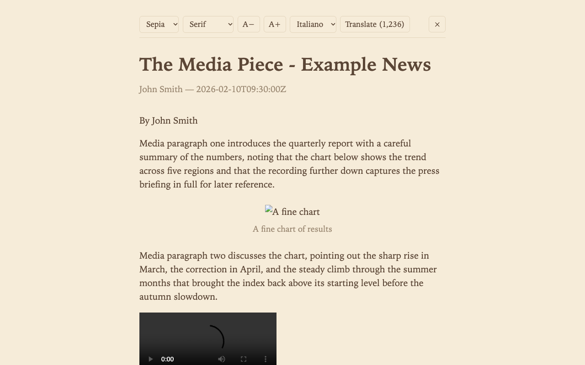
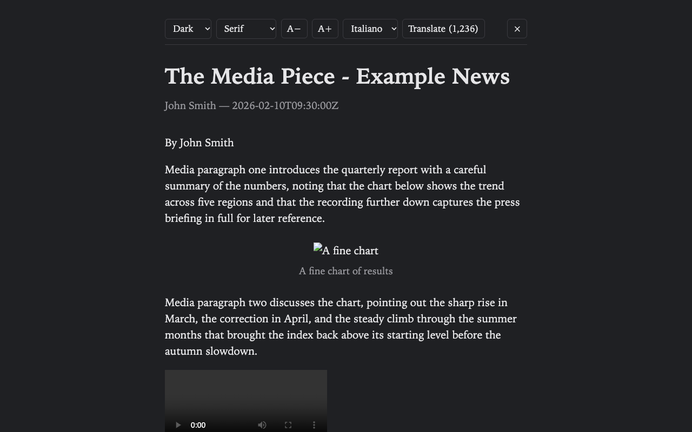

# Reader Mode AI

Chrome extension (Manifest V3) that adds an elegant, Safari-inspired reader mode and
translates article text in place with the DeepL API.

**Also available in Italian: [README.it.md](README.it.md)**

| Reader — sepia theme | Reader — dark theme |
|---|---|
|  |  |

## Features

- **Safari-style reading mode**: centered ~36em column, serif typography, title/byline/date
  header; white, sepia, gray and dark themes; adjustable font family and size, persisted.
- **AI translation**: full in-place text replacement into EN, IT, ES, FR or DE via the
  **DeepL API Free** tier (bring your own free key). Images, video and charts keep their
  position and are **never sent** to the provider. Inline markup is preserved.
- **Smart caching**: translated strings and articles are cached locally — reopening a
  translated article shows it translated instantly, with **zero API calls**.
- **Fast access**: `Alt+R` or the toolbar button; an `R` badge marks pages with a
  recognized article. Localized UI (en/it), `prefers-reduced-motion` respected.

## Quick start

1. `npm install && npm run build`
2. `chrome://extensions` → Developer mode → "Load unpacked" → select `dist/`
3. Extension icon → **Options** → paste your [DeepL API free key](https://www.deepl.com/pro-api)
4. Open any article and press `Alt+R`

## Development

| Command | Purpose |
|---|---|
| `npm run build` | bundle into `dist/` (esbuild) |
| `npm test` | unit tests (Vitest) |
| `npm run test:e2e` | end-to-end tests (Playwright, stub DeepL server, no real API calls) |
| `npm run screenshots` | regenerate `docs/assets/` screenshots |
| `npm run zip` | store-ready `reader-mode-ai-v<version>.zip` |

## How it works

- Article extraction: [Mozilla Readability](https://github.com/mozilla/readability)
  (MPL-2.0, see `src/vendor/NOTICE`) with a heuristic fallback.
- Translation pipeline: text runs are collected around media nodes, chunked, sent to DeepL
  with `tag_handling=html`, and swapped in place — media nodes are never touched.
- Caching: FNV-1a keyed string cache + article→language memory in `chrome.storage.local`.
- One service-worker request per chunk: MV3 worker termination cannot break a translation.

## Privacy

No analytics, no own servers. Article text is sent to DeepL **only** when the user presses
Translate. API key and cache stay in `chrome.storage.local`. See [docs/privacy.md](docs/privacy.md).

## Contributing

See [CONTRIBUTING.md](CONTRIBUTING.md). Issues and PRs are welcome.

## License

[MIT](LICENSE). Translation extraction uses `@mozilla/readability` (MPL-2.0).
